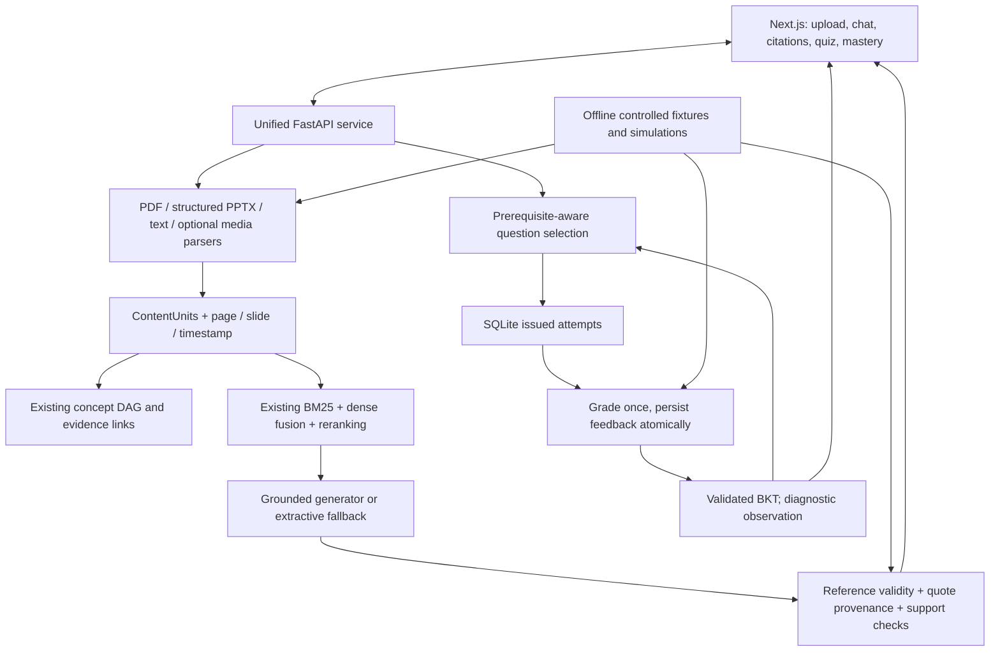

# Improvement design — November 5, 2026

Design recorded before implementation. Baseline: clean `main` at `42b0b63cf0e8334597ff53d00b91995fe962cc73`; working branch `improvement/pramana-evidence-audit`. Reference: `40af0e1c7a2db509cf26e57d9acb55cd90791108` in a separate sibling directory. Existing audit fixes remain the starting point.

## Validated gaps and intended changes

1. Grounding: lexical overlap is insufficient evidence of entailment; requested model verification currently accepts missing verdicts. Keep existing retrieval, add explicit evidence/provenance labels, reject malformed requested verification, test numeric/negation contradictions. Exact source spans establish provenance, not semantic truth.
2. Assessment lifecycle: `/answer` accepts unissued questions and repeated requests, each increasing mastery. Add durable attempt IDs issued by `/quiz` and `/diagnostic`, idempotent grading and one SQLite transaction for the attempt, learner profile and completed result. Existing clients can omit an attempt ID for an unambiguously issued item; the UI sends it. Unissued items are rejected. Reissuing an item creates a distinct practice attempt.
3. Learner: quiz planning manufactures mastery and can bypass prerequisites. Select using observed mastery; validate BKT numeric parameters; diagnostic observation should infer knowledge without assuming a teaching transition. Do not invent forgetting rates or chat mastery from passive questions.
4. Ingestion: ordinary PPT extraction reads text shapes but drops tables, group children, speaker notes and Office Math. Read structured native objects before considering costly vision. Preserve slide locators and label notes. Test with synthetic slides owned by this project, no reference course assets.

## Architecture

## Interfaces, persistence and failure behavior

- Additive API fields: `attempt_id` on issued questions and answer requests; replay flag and mastery-change explanation on feedback; explicit verification metadata on answers/claims. Existing source/concept IDs and question schema retained.
- SQLite migration uses `CREATE TABLE IF NOT EXISTS` for attempts; existing learner profiles stay readable. No destructive migration. Protect process-local mutation with the existing lock and restore memory on failed writes. This is still a single-process local app, not multi-tenant authorization.
- Pure PPT parsing adds no provider call or dependency. Office Math is represented as readable linear math, not a certified LaTeX reconstruction. Diagrams/scans still need optional vision.
- Provider verifier failures degrade to cited excerpts; tests must ensure unsupported generated sentences are not shown as verified. No new provider spending is authorized.
- Validate with baseline suite (229 Python, 18 frontend tests passed), new failure reproductions, API workflows, frontend contract/render tests, build/typecheck, real loopback smoke and reproducible fixture benchmarks. Hosted-model quality and real learning gains remain unmeasured.

## Cost and risk

All default improvements are local. Parsing cost grows linearly with slide XML; attempt writes add one small SQLite transaction per issue/answer. Grounding deterministic checks are linear in selected evidence. Optional verifier remains a configured model call. Risks: stricter rejection/shorter quizzes, stale clients after reissuance, and incomplete mathematical syntax. Tests and explicit labels bound these risks; no retrieval/model replacement is justified by current evidence.
