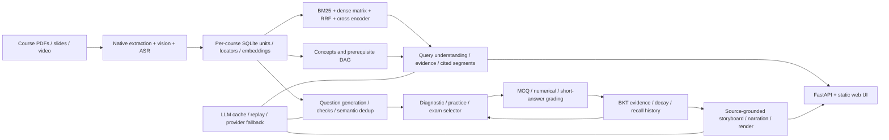

# Pramana: source-based architecture audit

Audit date: 2026-11-05. Reference commit: **40af0e1c7a2db509cf26e57d9acb55cd90791108**. The separate sibling checkout is `../pramana-reference`; none of its application files or course assets were copied into Saarthi. “Implemented” below means inspected code, not a successful full application run.

## Execution and evidence boundaries

The manifests and execution paths were reviewed before running tests. An isolated virtual environment used installed system packages without installing models. [The audit runner](../../scripts/audit_reference_tests.py) passes an allowlist of environment variables, refuses a reference `.env`, sets replay/offline modes and blocks network connections within the Python process. This is a defensive test harness, not an OS security sandbox.

The full suite could not collect because **pypdfium2 is missing**. A selected assessment/learner/schedule subset passed **27 tests in 1.70 seconds**. No course ingestion, hosted generation, transcription model, speech model, full web workflow, or lesson render was executed. Published evaluation scores are not independently reproduced scores. The linked YouTube demo could not be fetched and was not watched.

## System map

### Ingestion and provenance

[PDF ingestion][pdf] uses PDFium for page text, geometry and images. Default processing uses vision on each page, including equations and figures that the text layer misses. A text-only mode exists for ablations. Roughly 150-word passages preserve headings and nearby equations; source/page rectangles and figure crops support later inspection. Exercise-heading stop rules are course heuristics. Vision can introduce transcription errors; geometry establishes location, not mathematical correctness.

[Slide ingestion][slides] reads native text, tables, Office Math/AlternateContent and notes. Vision is selective: detected math images or pictures above a slide-area threshold can trigger it. A slide becomes a source unit; very short slides are skipped. This is a better native-first design for ordinary slides than applying a VLM indiscriminately. Rendering with Pillow is an approximation of PowerPoint layout.

[Video ingestion][video] combines faster-whisper word timestamps with sentence passages and board descriptions from a nearby video frame, usually near a passage's end. Transcript and frame units share media locators. Retrieval combines useful modalities and suppresses duplicate moments. This can recover material spoken narration omits; its quality depends on frame choice, ASR, visual transcription and alignment. It does not establish that every board change is captured.

[Ingestion storage][ingest] and [common helpers][common] cache work using digests. Replacing a source removes stale units, embeddings and concept associations. The multi-step rewrite is not one crash-safe transaction. Filename-derived IDs and retagging effects warrant explicit replacement tests.

### Retrieval and answering

[Index in retrieve.py][retrieve] keeps embeddings in an in-memory NumPy matrix, with exact similarity search, BM25 (k1 1.5, b 0.75), reciprocal-rank fusion, candidate pool 24 and top-k 6 defaults. RRF uses 1/(60 + zero-based rank); Saarthi uses one-based ranks. This small convention difference is not evidence of superiority. Default local models are bge-small-en-v1.5 embeddings and ms-marco-MiniLM-L-6-v2 reranking via fastembed. Source/concept filters restrict candidates. Exact search costs O(Nd); an ANN database would add complexity without demonstrated need at the sample scale.

[Tutor orchestration][tutor] first asks a small model to understand/rewrite intent and extract chat/check signals. Weak-prerequisite passages can supplement ordinary retrieval. Answer segments use temporary S1-style evidence tokens. Unknown IDs and uncited segments are dropped; no accepted segments produces refusal; outside knowledge requires opt-in. The -3.0 “no evidence” threshold was calibrated using the same 53-question evaluation set, so reported refusal performance is not held-out calibration evidence.

[Citation helpers][cite] select relevant excerpt text and construct page/rectangle, slide and timestamp links. These are useful UX and provenance mechanics. **Runtime source-token validity is not semantic entailment verification.** A wrong assertion can cite a real passage. Later evaluation judges support; that does not make each runtime answer independently verified.

### Learner model and selection

[Learner code][learner] uses a BKT-like update with type- and difficulty-dependent observation likelihoods. For binary observations, the usual posterior is:

- correct: p(1-slip) / [p(1-slip) + (1-p)guess];
- incorrect: p·slip / [p·slip + (1-p)(1-guess)];
- teaching transition: posterior + (1-posterior)·learn.

Partial scores blend correct/wrong evidence. Defaults include prior .25, learning .15, forgetting floor .1 and time constant 7 days. Successful recalls increase the retention time constant (growth .7). Guess probability starts from type chance (MCQ .25, short .05, numeric .03, chat .20), then adds difficulty-dependent partial-knowledge probability. Slip rises from .10 with difficulty. Chat evidence is discounted. Wrong responses are capped against increasing mastery; prerequisite evidence propagation has a share/headroom bound.

These assumptions are interpretable and richer than constant-parameter BKT, but are not fitted student/item calibration. Propagating to prerequisites can amplify an incorrect graph. Conversation inference can misread a student's question as evidence of competence. Logging before/after evidence helps inspection, not validity by itself.

[Assessment selection][select] combines weakness, prerequisite readiness, uncertainty and forgetting, with repetition penalties and semantic similarity filtering. Practice seeks predicted success around .85; diagnostics prioritize uncertainty and reach, then expected information, limiting types to MCQ/numeric. Exams balance topics and difficulty. This is more integrated than Saarthi's topic round-robin diagnostic, but the selection objective must be evaluated under a student model that does not simply reward its own assumptions.

### Assessment, verification and misconceptions

[Generation and verification][generate] check question structure, four distinct MCQ options, valid answer keys, source tokens and meaningful stems. Numerical items use an allowlisted arithmetic expression and recomputation (roughly 1% tolerance), plus a model solve check (roughly 2%). Question embeddings deduplicate stems plus answers at a .935 threshold; practice selection also considers .88 similarity to seen/taken items. Similarity thresholds need calibration: cosmetic rewrites and distinct questions can be confused.

The intended verifier model differs from the generator, **but the configured fallback can reuse the generator if no alternative remains**. Short-answer checking sees the proposed reference answer, so it is not blind solving. Distinct model names/providers do not prove independent errors. Cached results may also reflect an earlier model.

[Numerical helpers][numeric] safely evaluate allowlisted AST arithmetic and parse supported numeric representations. [Grading][grade] gives option-linked MCQ misconception explanations, numerical signatures such as sign/unit/missing-factor errors, and short-answer scoring. Keyword-overlap fallback for short responses can accept negation or miss valid paraphrases. A signature is a possible error explanation, not a psychological diagnosis; multiple consistent observations would improve reliability.

### Personalized lessons

[Storyboard code][script] selects source material and either a recorded learner mistake or an example, writes grounded narration and ordered worked steps, and closes with a question. Source IDs and narration are checked. Focus matching normalizes away math and punctuation; an invalid focus may be cleared while narration remains. These checks do not prove every narrated claim follows from the material.

[Build orchestration][build] renders sources, aligns spoken phrases, uses local Kokoro narration and may use transcript audio. [Rendering][render] combines Pillow, PyAV/FFmpeg and KaTeX into video. This is a real integrated implementation in source, not merely an advertised button. End-to-end latency, resource use, accessibility, pedagogy and successful rendering were **not measured here**. A source-linked text remediation workflow is the lower-risk next step for Saarthi.

### Graph, engineering and evaluation

[Concept mapping][concepts] constrains prerequisites to concepts earlier in extraction order, forcing a DAG. Acyclicity does not establish causal prerequisite validity. Unit tagging combines embedding candidates with model assignment. Saarthi already records richer edge evidence, confidence and validation signals; replacing that graph would lose useful traceability.

[LLM infrastructure][llm] caches structured calls, records usage, supports replay, limits rates and falls back across providers/models. Replay misses fail without network calls. Cache retrieval can precede model selection and keys do not necessarily distinguish actual selected model identity. Replay proves repeatability of stored outputs, not fresh-model quality, and cached course text retains its source license/privacy obligations.

[API][api] exposes course-scoped databases, uploads, chat, assessment, learner history and lesson jobs to a static JavaScript frontend. Course slugs are validated, but user IDs are not authentication. Upload reads are chunked without a total-size cap; background daemon jobs and their status are process memory, not a durable queue. Media containment is not complete tenant authorization. This remains a prototype.

[Evaluation design][evaluation] uses 53 questions (39 in scope, 14 off material), including assistant-authored questions and references built from the full vision-enriched knowledge base. Gold page recall can credit a page whose text omitted the needed equation. Vision-content recall is useful, but its reference construction favors the full pipeline. A swapped-context negative control is valuable; independent expert labels and held-out thresholds remain missing. RAGAS is a model judge, with shared-family error correlation and cache/replay caveats.

[Simulation][simulate] compares policies across six profiles, seven sessions and eight questions per session, using continuous proficiency, guessing, difficulty and forgetting. A flat control removes readiness/difficulty learning advantages, which is a useful sensitivity analysis. Tuning and evaluation on the same synthetic profiles cannot demonstrate real educational effectiveness. No controlled head-to-head score against Saarthi is justified.

## Licensing and reuse

The [MIT code license][license] credits Yi Yu (2026). [NOTICE.md][notice] excludes course material and derived caches: OpenStax and MIT OCW material is listed as CC BY-NC-SA 4.0; Collin slides as CC BY 4.0. Do not treat the sample course as MIT data. This audit independently implemented general engineering ideas and project-owned synthetic fixtures; it reused no Pramana code or course assets.

[pdf]: https://github.com/yy5652-hash/pramana/blob/40af0e1c7a2db509cf26e57d9acb55cd90791108/pramana/ingest/pdf.py
[slides]: https://github.com/yy5652-hash/pramana/blob/40af0e1c7a2db509cf26e57d9acb55cd90791108/pramana/ingest/slides.py
[video]: https://github.com/yy5652-hash/pramana/blob/40af0e1c7a2db509cf26e57d9acb55cd90791108/pramana/ingest/video.py
[ingest]: https://github.com/yy5652-hash/pramana/blob/40af0e1c7a2db509cf26e57d9acb55cd90791108/pramana/ingest/__init__.py
[common]: https://github.com/yy5652-hash/pramana/blob/40af0e1c7a2db509cf26e57d9acb55cd90791108/pramana/ingest/common.py
[retrieve]: https://github.com/yy5652-hash/pramana/blob/40af0e1c7a2db509cf26e57d9acb55cd90791108/pramana/retrieve.py
[tutor]: https://github.com/yy5652-hash/pramana/blob/40af0e1c7a2db509cf26e57d9acb55cd90791108/pramana/tutor.py
[cite]: https://github.com/yy5652-hash/pramana/blob/40af0e1c7a2db509cf26e57d9acb55cd90791108/pramana/cite.py
[learner]: https://github.com/yy5652-hash/pramana/blob/40af0e1c7a2db509cf26e57d9acb55cd90791108/pramana/learner.py
[select]: https://github.com/yy5652-hash/pramana/blob/40af0e1c7a2db509cf26e57d9acb55cd90791108/pramana/assess/select.py
[generate]: https://github.com/yy5652-hash/pramana/blob/40af0e1c7a2db509cf26e57d9acb55cd90791108/pramana/assess/generate.py
[numeric]: https://github.com/yy5652-hash/pramana/blob/40af0e1c7a2db509cf26e57d9acb55cd90791108/pramana/assess/numeric.py
[grade]: https://github.com/yy5652-hash/pramana/blob/40af0e1c7a2db509cf26e57d9acb55cd90791108/pramana/assess/grade.py
[script]: https://github.com/yy5652-hash/pramana/blob/40af0e1c7a2db509cf26e57d9acb55cd90791108/pramana/lesson/script.py
[build]: https://github.com/yy5652-hash/pramana/blob/40af0e1c7a2db509cf26e57d9acb55cd90791108/pramana/lesson/build.py
[render]: https://github.com/yy5652-hash/pramana/blob/40af0e1c7a2db509cf26e57d9acb55cd90791108/pramana/lesson/render.py
[concepts]: https://github.com/yy5652-hash/pramana/blob/40af0e1c7a2db509cf26e57d9acb55cd90791108/pramana/ingest/concepts.py
[llm]: https://github.com/yy5652-hash/pramana/blob/40af0e1c7a2db509cf26e57d9acb55cd90791108/pramana/llm.py
[api]: https://github.com/yy5652-hash/pramana/blob/40af0e1c7a2db509cf26e57d9acb55cd90791108/pramana/api.py
[evaluation]: https://github.com/yy5652-hash/pramana/blob/40af0e1c7a2db509cf26e57d9acb55cd90791108/docs/evaluation.md
[simulate]: https://github.com/yy5652-hash/pramana/blob/40af0e1c7a2db509cf26e57d9acb55cd90791108/evaluation/simulate.py
[license]: https://github.com/yy5652-hash/pramana/blob/40af0e1c7a2db509cf26e57d9acb55cd90791108/LICENSE
[notice]: https://github.com/yy5652-hash/pramana/blob/40af0e1c7a2db509cf26e57d9acb55cd90791108/NOTICE.md
