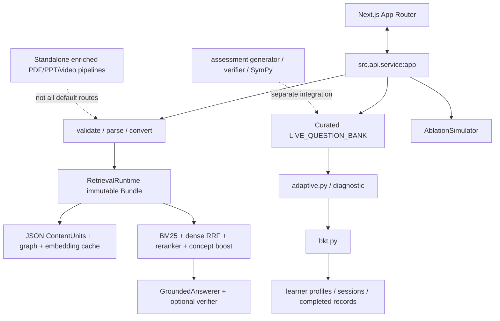

# Saarthi baseline

Recorded before this improvement round on 2026-11-05. Repository root is the nested `Saarthi-A-Verified-Grounded-Adaptive-Tutor-main` directory containing `.git`, `src` and `README.md`. Starting branch **main**, commit **42b0b63cf0e8334597ff53d00b91995fe962cc73**, clean working tree. Changes are on **improvement/pramana-evidence-audit**. The [prior engineering audit](../ENGINEERING_AUDIT.md) already fixed many defects; those fixes are part of this baseline, not new accomplishments.

The reference snapshot and this baseline are later audited states, not proven competition-deadline commits. A current-source comparison must not be presented as a reconstruction of each team's exact hackathon submission.

## Application map and maturity

| Area | Source and actual baseline behavior |
|---|---|
| Entry points | [Unified API](../../src/api/service.py); separate [Pod B API](../../src/retrieval/api.py); alternate `backend/app` ingestion API. The unified service is the tested frontend backend. |
| Ingestion | [Upload route](../../src/api/service.py) validates type/size, sanitizes filenames and reports parsing failure. Text/PDF/basic PPT parsing is local. [Standalone ingestion pipelines](../../src/ingestion/ingestion/) include image extraction, captioning, transcription and checkpoints; their existence does not establish the unified PDF/PPT route uses all enrichments. |
| Native PPT gaps | `extract_ppt_content` handled ordinary text shapes but omitted tables, grouped shapes, speaker notes and Office Math. The same omission existed in the mirrored parser. Image-only slides, embedded objects and raster/vector equations remain distinct problems. |
| Video/audio | Transcription and timestamped segments exist. The unified fallback can use the full video pipeline after transcription failure; successful ASR does not ensure board figures are indexed. No measured ASR/OCR/diagram quality. |
| Chunking | Source locators survive conversion to `ContentUnit`. Page/slide chunks and transcript segments are not a comprehensive document hierarchy. Existing chunking benchmarks/tests were preserved; no parent-child retrieval was added without comparative evidence. |
| Index state | [Runtime](../../src/retrieval/runtime.py) builds a replacement bundle before publishing it and reuses embedding caches. Per-file persistence is atomic, but corpus+graph+media are not one crash transaction. Source ID collisions and multi-worker coordination remain. |
| Retrieval | [HybridRetriever.search](../../src/retrieval/retriever.py): BM25+dense, RRF k=60, top-20 candidate pool, reranker, source-type/source-ID filters, +.2 concept-definition ordering boost. Gate uses unboosted relevance. Cached embeddings; hosted/local backends and hash512/lexical fallback. |
| Grounding | [GroundedAnswerer](../../src/retrieval/answer.py) already had claim references, valid-ID checks, lexical support, optional model checks, refusal/partial states, outside-knowledge separation and extractive failure fallback. The requested verifier could accept missing verdicts. Overlap alone admitted number/negation errors. |
| Source UX | Citations already had excerpts and source deep links; files are served with containment checks. Valid unit/page IDs were not semantic support guarantees, and exact quote offsets were missing. Some confidence/UI wording overstated verification. |
| Graph | [KnowledgeGraph](../../src/graph/graph.py) and [GraphBuilder](../../src/graph/graph_builder.py) retain evidence units, edge confidence/signals, validation and cycle pruning. This is already more traceable than a simple ordered DAG. LLM-proposed edges are still not independently established prerequisites. |
| Assessment | [Generator](../../src/assessment/generator.py), [blind verifier](../../src/assessment/verifier.py), [restricted SymPy check](../../src/assessment/sympy_check.py) and [dedup](../../src/assessment/dedup.py) exist. Groq/Gemini agreement is not proof. The default API uses a curated bank from [live_course_data.py](../../src/learner_model/live_course_data.py); uploads do not create verified course questions. |
| Grading | Deterministic normalized complete text and finite decimal/scientific-number matching. No substring correctness shortcut. Fraction/algebraic/semantic equivalence is not general. Source and math-check metadata in the curated bank are declarations, not newly executed verification. |
| Learner | [BKT](../../src/learner_model/bkt.py): prior .30, guess .20, slip .10, learn .15. Bayes observation followed by a teaching transition. A decay method exists but is not a scheduled forgetting-aware workflow. No passive-chat mastery update in the unified default workflow. |
| Adaptivity | [build_quiz](../../src/learner_model/adaptive.py) uses five difficulty bands and prerequisite threshold .60. Baseline planning manufactured +.05 mastery and could fall back to blocked concepts; planning is not learner evidence. Diagnostics sampled topics, but answer processing lost their no-teaching distinction. |
| Persistence | SQLite stores learner/chat/history state, but `/answer` accepted unissued q_ids and retries counted as fresh learning observations. Session ownership/authentication is absent. |
| Feedback/lessons | Correctness, answer explanation, mastery board and weak-concept report exist. No integrated personalized lesson/video pipeline. “Likely issue” from one mistake was too strong; a report also mishandled Pydantic source locations. |
| Evaluation | [Golden development queries](../../src/retrieval/golden.py), [grounding evaluator](../../scripts/eval_grounding.py), simulation and optional RAGAS integrations exist. `/eval/ragas` correctly returns not_measured in this setup. No real student study or held-out model evaluation. |
| Product | Next.js chat, sources, graph, quiz, benchmark; loading/error handling has prior tests. FastAPI provider configuration and offline mode are useful. No authentication, tenant/course isolation, durable job queue or production deployment assurance. |

## Baseline execution

Installed environment: Windows, Python 3.12.10, Node 25.8.0, npm 11.11.0. Existing dependencies were used; this was not a clean-room reinstall. Python manifests have optional ML/media dependencies and are not completely locked. Offline settings: hash embeddings, lexical reranking, no LLM, dotenv disabled, HF/Transformers offline.

- Python regressions: **229 passed**, 5.63 seconds.
- Frontend checks: **18 passed**; typecheck passed.
- Prior production build had passed with available network. The new offline build attempt exposed Google-font fetching; this round removed that build dependency.
- Frontend lint: **21 errors, 34 warnings**. This remains a tracked baseline limitation.
- Pramana full-run limitations are recorded separately in [its audit](PRAMANA_ARCHITECTURE.md); no unmatched score comparison is made.

## Quantitative starting point

[controlled-before.json](controlled-before.json) was measured against a Git archive of the exact baseline with the same harness used after changes.

| Measurement | Baseline |
|---|---:|
| Corpus / in-scope / off-topic / near-miss fixtures | 28 / 20 / 10 / 4 |
| Retrieval hit@1 / hit@3 / MRR@3 | .95 / 1.00 / .975 |
| Precision@3 / recall@3, gold-unit labels | .4667 / .9208 |
| In-scope answered / off-topic refused / near-miss not grounded | 19/20 / 10/10 / 4/4 |
| Authored slide probes recovered | 1/7 |
| Quiz request 25: returned / prerequisite violations | 25 / 14 |
| Same correct answer submitted twice: mastery / history | .7098 → .9292 / 2 |
| Scripted invalid claims rejected | 0/5; valid accepted 4/4 |
| Simulation final mastery, adaptive / random | 39.4% / 39.5%, 600 items each |

Development fixtures are small and partly tailored to existing behavior. These results are engineering baselines, not broad educational or semantic accuracy. See [benchmark protocol](BENCHMARK_RESULTS.md) for timing, resource measurements, after results and limitations.
